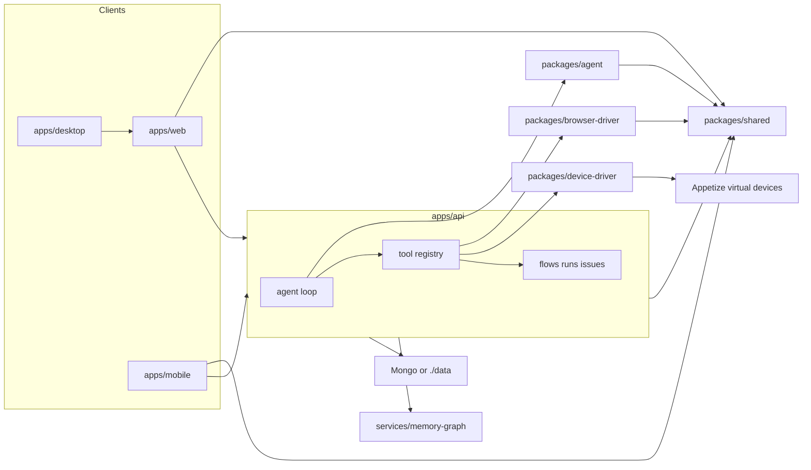
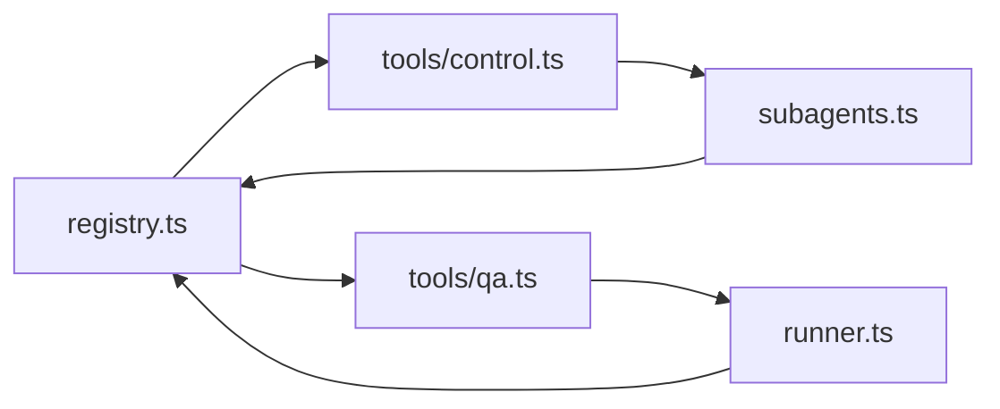

# KaDeep Studios architecture (from the graph)

This is the written map. The queryable map is generated on each machine at [graphify-out/](../graphify-out/) and is not committed. Start at [wiki/index.md](../graphify-out/wiki/index.md) after `./scripts/setup-graphify.sh`. How to query and keep the graph fresh: [GRAPHIFY.md](GRAPHIFY.md).

The graph is **code structure** (AST). It does not replace product docs, and it is not the Zep/Neo4j memory sidecar in `services/memory-graph`.

## Layout and coupling

Folder layout matches [README.md](../README.md). The graph’s real edges are:

- **Execution plane** (`apps/api/src/jobs/`): runs are durable jobs in the `jobs` collection, claimed with atomic leases by the API's inline worker and by `src/worker.ts` (Railway `worker` service), checkpointed per case, controllable from any device (`routes/jobs.ts`). Persisted HITL (`services/hitl.ts`), product model (`services/product-model.ts`) and structured decisions (`services/decisions.ts`) keep state outside the conversation. Details: [SCALING.md](SCALING.md).
- Platform plumbing (`services/redis.ts`, `services/locks.ts`, `services/health.ts`, `services/log.ts`, `db/indexes.ts`): Redis-backed Socket.IO fan-out, scheduler leader lease, `/api/health` platform block, request ids, hot-path indexes.
- `apps/web` and the desktop shell share one React UI. Mobile is a separate Expo app on the same API. The phone **Watch live** screen is view-only frames for browser, Appetize and paired desktop.
- `packages/shared` is the type contract (`Artifact`, `Flow`, `User`, `MemoryLayer`, …). Many “surprising” edges in the report are just API/UI types meeting here.
- `packages/browser-driver` owns `BrowserSession`. API tools call it; they should not absorb it.
- `packages/device-driver` owns `DeviceSession` (Appetize SDK hosted in headless Playwright) behind the `DeviceDriver` interface; `apps/api/src/agent/tools/mobile.ts` mirrors `tools/browser.ts` on top of it, and `ensureDevice()` in `context.ts` is the API-side factory. Product doc: [MOBILE.md](MOBILE.md).
- `packages/agent` is the OpenRouter tool-calling loop (`runLoop()`), used by `runChatTurn()` / runner.
- `apps/api/src/services/llm-keys.ts` is the only place an OpenRouter key is resolved: per-user key (BYOK, encrypted, `/api/settings/llm`) → optional shared `OPENROUTER_API_KEY`. Every model call site (`runChatTurn`, scheduler, CI, MCP, curator, continuity) goes through `requireApiKey` / `apiKeyOrEmpty`; key/account failures become the `llm` agent event the web banner reacts to.
- Workspace **Dashboard** (`apps/web/src/workspace/dashboard/DashboardView.tsx`, `GET /api/projects/:projectId/dashboard`) is the project QA release view: readiness, gates, execution, coverage heatmap, defects, leakage, predictions and productivity, all from `qaDashboard()` in `apps/api/src/services/dashboard.ts`. Cost collapses without `cost:view:project`; team performers need `dashboards:runtime`. The lead agent reads the same payload via `qa_dashboard` and draws arbitrary live infographics via `compose_analytics` (recipe catalog in `apps/api/src/services/analytics-recipes.ts`) on the same chart UI. Manager/admin altitude still uses `EnterpriseShell`.

## God nodes vs utility gravity

Most connected symbols in [GRAPH_REPORT.md](../graphify-out/GRAPH_REPORT.md):

| Symbol | Why it ranks | Treat as |
|---|---|---|
| `BrowserSession` | Playwright session; ~79 edges into runner, QA tools, gates, snapshots | Product hub — change with `graphify affected` |
| `runChatTurn()` | Chat turn entry into the agent loop | Product hub |
| `collection()` | Mongo/JSON store accessor | Utility gravity — too many callers |
| `newId()` | ID helper | Utility gravity |
| `useTheme()` / `useSession` / `useActiveProject()` | React/session hooks | UI gravity, not domain |

`express` and `typescript` also show high betweenness because manifests and the API server import them. Ignore those as architecture.

## Seams the graph already draws

### Browser vs API tools

[Browser Session Manager](../graphify-out/wiki/Browser_Session_Manager.md) is the kernel. Neighbors: [Agent Runner Tools](../graphify-out/wiki/Agent_Runner_Tools.md), [Agent Budget Gates](../graphify-out/wiki/Agent_Budget_Gates.md), [Browser Navigation](../graphify-out/wiki/Browser_Navigation.md), [Browser Interaction Tools](../graphify-out/wiki/Browser_Interaction_Tools.md), [Browser Snapshot Types](../graphify-out/wiki/Browser_Snapshot_Types.md).

`ClientSession` in `apps/api/src/agent/context.ts` references `BrowserSession`. `ensureBrowser()` is the API-side factory.

### Agent registry cycles (backlog — do not “fix” in a drive-by)

Both cycles are listed in the graph report. A future split: catalog (`allTools` / `toolsForGroups`) vs runtime (`executeFlowIn` / `runChatTurn`) so tools do not import the runner that imports the registry. Tracked only — no moves in this living-map pass.

Wiki: [HITL Tool Registry](../graphify-out/wiki/HITL_Tool_Registry.md), [Subagent Definitions](../graphify-out/wiki/Subagent_Definitions.md), [Agent Session Context](../graphify-out/wiki/Agent_Session_Context.md).

### Memory is one product, several clusters

| Community | Where |
|---|---|
| [Memory Store and Graph](../graphify-out/wiki/Memory_Store_and_Graph.md) | `apps/api/src/memory/store.ts`, graph client, facts/events |
| [Memory Curation](../graphify-out/wiki/Memory_Curation.md) | curator, proposals, tombstones, PII guard |
| [Memory Retrieval](../graphify-out/wiki/Memory_Retrieval.md) | `recall()` / `MemoryLayer` / `MemoryKind` |
| [Memory Graph Service](../graphify-out/wiki/Memory_Graph_Service.md) | `services/memory-graph` (Graphiti / Neo4j) |

A future organize pass would give `apps/api/src/memory/` a single entry and keep the sidecar behind `graph.ts`. Not done here.

### Artifacts are split across API, agent tools, and web

[Artifact Processing](../graphify-out/wiki/Artifact_Processing.md) · [Artifact Spec Builder](../graphify-out/wiki/Artifact_Spec_Builder.md) · [Artifact Context Mentions](../graphify-out/wiki/Artifact_Context_Mentions.md) · [Artifacts View UI](../graphify-out/wiki/Artifacts_View_UI.md)

Shared `Artifact` / `SaveInput` / `TurnArtifacts` / `UploadResult` is the glue. A future package or a single API module would collapse the islands.

### Secrets vs auth vs projects

[Secrets Vault and Projects](../graphify-out/wiki/Secrets_Vault_and_Projects.md) (`encryptSecret` / vault records, plus `projects()`) is clustered away from [Auth and Passwords](../graphify-out/wiki/Auth_and_Passwords.md). Keep credentials out of the three memory layers — that split is intentional.

### Desktop is a driver contract plus a transport, not a third runner

`packages/desktop-driver` owns the `DesktopDriver` contract (the same shape as `DeviceDriver`); `CuaDesktopSession`
fulfils it locally over MCP, `RemoteDesktopDriver` (`apps/api/src/desktop/remote.ts`) fulfils it over `worker:call`
RPCs to a paired machine, and the Electron app's `SessionHost` is the other end of that RPC holding a
`CuaDesktopSession`. Tools in `agent/tools/desktop.ts` only see the contract. Keep OS-specific behaviour inside the
package (`ext.ts`), never in the tools or the Electron host. See [DESKTOP.md](DESKTOP.md).

### Local mobile devices reuse the desktop seam

`packages/device-driver/src/local/` holds `LocalAndroidSession` (adb + emulator gRPC) and `LocalIosSession` (`simctl` +
WebDriverAgent), both on `NativeDeviceBase`, exported Playwright-free as `@teststudios/device-driver/local`. The
Electron `DeviceSessionHost` (`apps/desktop/src/main/device/`) hosts them behind method allow-lists and reports the
installed inventory on the heartbeat; `RemoteDeviceDriver` (`apps/api/src/desktop/remote-device.ts`) fulfils
`DeviceDriver` over `worker:call`. `ensureDevice()` picks Appetize or local per platform from `project.mobile.runOn`,
never falling back silently. Decision record: [LOCAL-DEVICES.md](LOCAL-DEVICES.md).

### Governance sits between the chat and the queue

`services/envelopes.ts` → `services/campaigns.ts` → `jobs/dispatch.ts` is a one-way seam: the planner's `propose_campaign` tool builds the costed object, `approveCampaign` stamps `campaignId / trancheId` onto ordinary jobs, and the worker calls back into `campaigns.ts` (`recordCampaignSpend`, `onCampaignJobFinished`) through dynamic imports so `jobs/worker.ts` never imports the service statically. `services/approvals.ts` is deliberately subject-agnostic: it knows chains, deputies, timers and links; `onApprovalFinal` in `campaigns.ts` is the only place a decision turns into work. Keep new gated subjects (a destructive tool call, an envelope boost) on that hook rather than teaching approvals about them. See [CAMPAIGNS.md](CAMPAIGNS.md).

### The lead orchestrates; bulk work is a swarm on the queue

The lead agent works like a Claude Code session: `runLoop` runs parallel-safe tool calls of one step together
(`ToolDef.parallelSafe`; anything that drives a shared browser, device or desktop stays serial), `spawn_agent` starts a
typed agent (`subagent-defs.ts`: tier, tool groups, isolation) in the background through the per-chat `AgentHost`
(`agent/agents.ts`), and finished agents' compact reports are injected as `<agent-notification>` messages through the
loop's inbox. Bulk work goes to `swarm` (`apps/api/src/swarm/`): shards are `swarm_shard` jobs, so they are durable and
spread across replicas exactly like runs; the worker reaches `swarm/` only through dynamic imports. Parallel authors share
one dedupe ledger (`swarm_claims`), flow keys and issue groups are serialised per project. Scarce things are slots in the
same `slots` collection: browsers, devices (a warm device carries its slot, `swarm/warm-devices.ts`), the paired desktop and
test accounts. A finished swarm reaches the lead through `swarm/continuation.ts`: its open turn's inbox, or a follow-up
turn when the turn has ended. See [SCALING.md](SCALING.md).

### Browser depth lives in the driver; the API only records it

Engine truth, emulation, HAR, network / storage / clock manipulation, download sniffing, blocker classification and
exploration bounds are all methods on `BrowserSession` (`packages/browser-driver`). The API side is thin: `tools/network.ts`
and `tools/explore.ts` call the driver and copy `browser.manipulations` / `blockReport()` / `build()` onto the `Run`;
`services/blockers.ts`, `auth-sessions.ts`, `matrix.ts`, `app-maps.ts` hold the persistence and the comparison logic.
Two rules keep this seam honest: every launch-time Playwright route uses `route.fallback()` (so read-only mode, the
domain allowlist, path bounds, bypass lanes and mocks compose instead of the last one winning), and nothing in the
codebase evades protection — `classifyBlock` names the mechanism and `REMEDIES` lists the lanes; see
[ACCESS-MODEL.md](ACCESS-MODEL.md). Exploration bounds (`Project.exploration`) are enforced in the driver
(`ExplorationBounds`, `BoundsError`), set on the context by `start_exploration` or the explorer sub-agent, never by prompt alone.

### Skills are data, packs are imports, benchmarks are evals with ground truth

`skills/<name>/SKILL.md` frontmatter (`surface`, `routes`, `precedes`, `follows`) is the only routing mechanism — `selectSkills`
reads it; no code names a skill except the three leads. External packs (`services/skill-packs.ts`) become project skills tagged
with their pack, never files in `skills/`. Benchmarks (`evals/benchmark/`) reuse the eval runner and fixtures; the only new
truth they add is the ground-truth registry in `packs.ts`, and the generated docs (`BENCHMARKS`, `LIMITATIONS`, `CAPABILITY-TIERS`)
are derived from code (device provider capability sheets, MCP presets) so the pitch cannot drift from the product.

## Communities worth opening first

Product (ignore `package.json` / `tsconfig` / “Dev Dependencies” articles):

- [Agent Session Context](../graphify-out/wiki/Agent_Session_Context.md)
- [Agent Runner Tools](../graphify-out/wiki/Agent_Runner_Tools.md)
- [HITL Tool Registry](../graphify-out/wiki/HITL_Tool_Registry.md)
- [Browser Session Manager](../graphify-out/wiki/Browser_Session_Manager.md)
- [Flows Suites and MCP](../graphify-out/wiki/Flows_Suites_and_MCP.md)
- [Chat Persistence](../graphify-out/wiki/Chat_Persistence.md)
- [Web Workspace UI](../graphify-out/wiki/Web_Workspace_UI.md)
- [Mobile App Shell](../graphify-out/wiki/Mobile_App_Shell.md)
- [Eval Check Runner](../graphify-out/wiki/Eval_Check_Runner.md) — `evals/`, not the product runtime
- [ACME Demo App](../graphify-out/wiki/ACME_Demo_App.md) / [Beyond Bank Fixtures](../graphify-out/wiki/Beyond_Bank_Fixtures.md) — fixture apps

Low cohesion (~0.05) on Mobile App Shell, Eval Check Runner, and Database Backend Stores means those clusters are bags of related files, not tight modules. Useful as a *future* split signal, not a rename this week.

### Localization is a second product kind, three seams

`packages/loc-formats` is pure (filters, segmentation, CLDR, TMX/TBX, zip). The API (`apps/api/src/loc/`) owns TM, terminology, QA rules, MT, deliveries and jobs. Browser / device / desktop **drivers** own in-context validation. Do not pull format parsers into the API, or loc services into the drivers. Product doc: [LOCALIZATION.md](LOCALIZATION.md).

### The project charter reaches the agent through one block, one tool and one skill

`packages/shared/src/charter.ts` is the structured charter (`ProjectCharter` on `Project`; projects without one keep today's behaviour through `LEGACY_RULES`). `apps/api/src/services/charter.ts` is the only writer (`saveCharter` → regenerated conventions, the always-on `product-knowledge` skill, product-model seeding); `apps/api/src/agent/charter-block.ts` renders it into the system prompt (full for the lead and runs, compact for sub-agents) and `tools/charter.ts` serves it on demand. Rule toggles are applied where the product already enforces behaviour (`agent/guards.ts`: read-only scoped to production, the destructive ask, PII masking), never as new tool contracts. "Create project" enqueues the `setup` job (`jobs/setup-worker.ts`): ordered idempotent steps whose events live in `checkpoint.state.events`, replayed by `GET /api/projects/:id/setup` and the web loader (`apps/web/src/setup/`). The LLM provider is one seam too: `packages/agent/src/provider.ts` adapters behind `complete()`, resolved per turn by `services/llm-keys.ts` (`resolveLlm`), with org-level connections in `services/llm-connections.ts`.

A localization charter adds its own section (`LocCharterSection`); `services/loc-charter.ts` renders its conventions and the always-on `localization-brief` skill, and the setup job's localization branch (`runLocSetup`) writes the brief into the settings the loc services already read (formality, gates, DNT, an approved-terms termbase) through their exported functions. The agent reads it from `agent/loc-charter-block.ts` (`locCharterBlock`, and `locAssetsBlock`: one line per asset with its counts, progress and summary). Loc model calls resolve the project's provider through `locLlm()` in `services/llm-keys.ts`, never a bare OpenRouter key.

### The setup loader warms the app; nothing waits for nothing

While the setup loader is up, `apps/web/src/warm/prewarm.ts` loads the views the project will open (the same `import()` factories `RightPane` and the loc viewers use, `lazyViews.ts`), fetches the exact cache keys those views read (`warm/keys.ts`, served once from `data.ts`'s warm store), and caches the setup's own files (`bytesCache.ts`, an LRU cleared on project switch). The loader opens itself when the blocking setup steps are done and the warm-up has settled, at most `PREWARM_CAP_MS` later; "Open workspace" is never held back. On the server the setup job's last step, `warm` (`services/prewarm.ts`), readies what the first turn reads: the model catalog, the LLM resolution, access scope, memory, connections, the product model and, for localization, the asset list. No browser or device is started.

### Integrations: one catalog, each tile on a real mechanism

`packages/shared/src/integrations.ts` (+ `integrations-catalog.ts`) is the only list of tools a project can connect; the setup's Connections page and Settings › Connect render it (`apps/web/src/charter/connections/`), and `connectors.ts` maps each entry to the mechanism that really connects it: native defect filing (`services/tickets.ts`), chat webhooks (`services/outbound.ts`), MCP presets, read-only databases, inboxes, CI tokens, or a tool's own REST API (`service` connections, `services/service-api.ts`) that the agent calls through `integration_request` with the credential added server-side. Outbound calls to an address a customer typed go through `services/net-guard.ts` (public hosts only). Logos are generated, bundled data (`scripts/build-integration-logos.mts`). Uploaded files get the agent's summary in the background (`services/artifact-gist.ts`), shown under the file and read by the agent from its file list.

### Accessibility audits: engines are pure, the API records, the drivers render

`apps/api/src/a11y/` runs audits of a subject (an asset in its original or a translated language, a URL, an app, a desktop app) as `a11y_audit` jobs. Engines (`a11y/engines/*`) take bytes or a driver session and return findings; `a11y/audits.ts` stores findings with stable fingerprints, the criteria table and score (`a11y/score.ts`), and links a source / translation pair. Standards and law lenses are data in `packages/shared/src/a11y-standards.ts`. Asset viewers live in `apps/web/src/loc/viewers/`; files the browser cannot draw are converted on the server first (`loc/render.ts`, plan shared through `renderPlanFor`, see [LOCALIZATION.md](LOCALIZATION.md#faithful-previews-locrenderts-loccardsts-weblocviewers)). Product doc: [ACCESSIBILITY.md](ACCESSIBILITY.md).

## Organize backlog (no code moves)

1. Break the two `registry.ts` import cycles (catalog vs runner).
2. Keep `BrowserSession` in `packages/browser-driver`; make API tools depend one way.
3. One memory entry module (store / curator / retrieve / graph / PII).
4. One artifacts module or package so web, agent tools, and API CRUD share a boundary.
5. Reduce `collection()` / `newId()` gravity when touching those files anyway.

Before any of those: `graphify affected "<symbol>"`, then `graphify update .` after the change so the local map stays honest. Do not commit `graphify-out/`.
