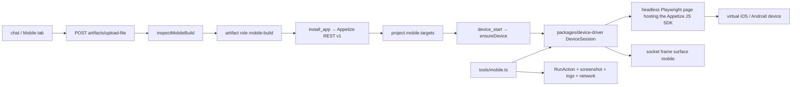

# Mobile device testing (Appetize)

The agent tests native iOS and Android apps the same way it tests sites: perceive, act on refs, verify, record, report. The surface is a virtual device on [Appetize](https://appetize.io); everything else — flows, suites, runs, defects, memory, skills, reports, HITL — is the platform you already have.

## What a user does

1. Add the Appetize token (`APPETIZE_API_KEY`, or Settings → Connect → Appetize).
2. Drop the build in chat — an Android `.apk` or a zipped iOS **simulator** `.app` (`MyApp.app.zip`). `.ipa` and `.aab` are refused with the fix (device builds do not run on Appetize; export a universal APK). In the Mobile tab's **Builds** panel you pick the **device and OS** the build is loaded on before adding it (the file decides the platform; the picker decides the model), and can change them per build afterwards.
3. Ask. "Smoke test the login", "run the regression on both platforms", "does it survive being killed mid-transfer?", "check accessibility and dark mode", "is anything sent over http?".

The agent installs the build (`install_app`), boots a device (`device_start`), reads the first screen and works exactly as it does in the browser. The Mobile tab shows the live device inside a phone mockup (`DeviceShell` — iOS or Android bezel, sized from the frame's real aspect ratio) with an Appetize-style control rail beside it (`DeviceSidebar`: Home, Back, Rotate, Shake, Light, Dark, Face, Save screenshot). Nothing is drawn on the stage until a device is live, like the browser tab. **Take control** lets you tap, swipe and type on the agent's device and hand back; the rail's device actions are enabled while you hold control (screenshot always works). **Stop** ends the session and frees the Appetize slot.

Watch from the **KaDeep Studios** phone app (More → Watch live, the camera on a running chat, or the Agent widget on Home). Browser, Appetize and paired desktop each have their own stream. The phone is view-only — take-control stays on web and the desktop app.

**Sandbox** is a second surface: an Appetize embed in your own browser (no agent session) for poking at one of your uploaded apps by hand, with the same control rail (plus Lock, volume on Android, keyboard on iOS). Two Appetize rules shape it:

- Appetize checks the embedding page's origin against the app's / account's embed allow-list, so the web origin (`PUBLIC_APP_URL`, `http://localhost:5173` in dev) must be allowed under Appetize → App permissions; a refusal is shown with that fix instead of failing silently.
- Appetize's **public demo apps (`demo_…`) only embed on appetize.io itself** — from any other origin the session fails with "This app may not be embedded on this website". So the Sandbox opens your newest app for the platform by default and only offers a bare "Home screen" when the account configured its own sandbox build (`APPETIZE_IOS_PUBLIC_KEY` / `APPETIZE_ANDROID_PUBLIC_KEY` / `APPETIZE_BUILD_ID`). With no app for a platform it says so and offers to boot a bare device through the agent instead, whose server-side harness can use the demo (it falls back to the appetize.io origin).

## How it is built

- **Frames** — the harness forwards Appetize's `video` JPEGs with their pixel size; the API broadcasts `frame { surface: 'mobile', jpeg, w, h }` and `POST /api/agent/device/screenshot` returns `{ jpeg, w, h }` from Appetize's own `session.screenshot()` (never a photo of the embed iframe), so the live view and the post-tap refresh share one framing. The harness viewport follows the booted device's screen aspect ratio (`harnessViewport`), so `scale: 'auto'` adds no letterbox or crop. Take-control taps are fractions of the drawn screen (letterbox-aware) and the API maps them to dips with the live snapshot.
- **`packages/device-driver`** — `DeviceSession` implements `DeviceDriver`: launch, `snapshot()` (native hierarchy → refs `[m12]` with role, name, id, label, value, states, bounds; dialogs and keyboard detected), tap / long-press / type / keys / swipe / drag / scroll-until, app lifecycle, environment (appearance, language, location, biometry, media, permissions, offline, notifications, battery, font scale — Android via an adb allow-list), logs and intercepted network, performance (adb `gfxinfo`, `meminfo`, `am start -W`), accessibility heuristics, JPEG frame streaming, self-heal by id / label / text. `MockDeviceSession` plays a scripted "DemoBank" app for tests and offline evals (`DEVICE_DRIVER=mock`).
- **`apps/api/src/agent/tools/mobile.ts`** — the `mobile` tool group. Same contract as browser tools (gate, budget, guards, record, self-heal) plus mobile guards: system-dialog stop-and-ask (`confirm_dialog`), destructive (`confirm_destructive`), production payments, real card numbers, adb data wipes.
- **Runner** — `flowSurface()` picks browser / device / both from `Flow.platform` (`web | ios | android | any`), the project's builds and the wording; device replay heals by accessibility id and skips one-time dialog taps; `run_suite(matrix="all" | [...])` runs every mobile flow on every target and reports parity gaps first.
- **Prompts & skills** — `VOICE` carries the mobile rules; `projectBlock` lists the builds; `mobile-qa-lead` plus ten `mobile-*` skills are picked when the turn looks mobile (build attached, device live, mobile words, or a mobile-only project).
- **Memory** — screens become `structure` facts tagged `platform:` / `device:` / `os:`; recall boosts facts for the active platform.
- **Reports & defects** — runs and issues carry `platform` and `device` (platform, model, OS, build, app id); the run report prints a Device line; `export_appetize_playwright` turns a recorded run into an `@appetize/playwright` spec.

## Tools

| Area | Tools |
|---|---|
| Session & app | `device_start`, `device_status`, `device_end`, `install_app`, `remove_app_build`, `launch_app`, `restart_app`, `reinstall_app`, `kill_app`, `background_app`, `open_deep_link` |
| Perceive | `device_snapshot`, `device_screenshot`, `find_on_screen`, `read_screen_text`, `wait_for_screen`, `device_logs`, `device_network` |
| Act | `tap`, `long_press`, `tap_at`, `type_text`, `device_type_variable`, `clear_field`, `press_key`, `swipe`, `scroll_until_visible`, `drag_gesture`, `rotate_device`, `shake_device`, `toggle_keyboard`, `add_media` |
| Environment | `set_appearance`, `set_language`, `set_location`, `set_network_condition`, `biometry`, `grant_permission`, `post_notification`, `set_battery_state`, `set_font_scale`, `adb_shell` |
| Quality | `assert_screen`, `measure_app_performance`, `device_accessibility_scan`, `visual_check_device`, `device_network_assert`, `export_appetize_playwright` |

Screenshots to keep, full pages, comparisons across languages / builds and annotated defect evidence: see [SCREENSHOTS.md](SCREENSHOTS.md).

## Limits the agent states instead of faking

- iOS in Appetize has no scriptable offline / airplane mode, battery, font scale or push; these are reported INCONCLUSIVE on iOS and covered on Android.
- Simulators / emulators have no SIM, camera hardware or APNs / FCM. Substitutes: `add_media` for pickers, `post_notification` (Android) for local notifications, `open_deep_link` for links, `biometry` for Face ID / fingerprint, `set_location` for GPS.
- TalkBack / VoiceOver cannot be driven; `device_accessibility_scan` predicts what they would announce and the skill asks for a manual pass.
- Certificate pinning cannot be tested (the emulator trusts the intercepting proxy); the agent says so.
- Appetize's public **demo** apps refuse datacenter / VPN addresses ("VPN is not allowed for demo"); uploaded builds are not affected. Run the API from a normal network to use the demo sandbox from the agent.
- Appetize's automation API offers tap and single-finger swipe only: `pinch_gesture` returns INCONCLUSIVE with the alternatives (double-tap zoom, zoom controls, Android accessibility magnification, a real-device lane). One build per session: `upgrade_app` returns INCONCLUSIVE with the two-run alternative (pre-upgrade steps on build A, post-upgrade on build B, state verified through the backend). Every such limit lands on `run.limitations`.
- `interrupt_device`: Android does `call` (dialer overlay), `alarm` (clock on top), `lock_unlock`, `low_memory` (`am send-trim-memory RUNNING_CRITICAL`) and `notification`; iOS supports `lock_unlock` only.

## Device lanes (882)

`packages/device-driver` exposes a `DeviceProvider` registry. A lane hands out `DeviceDriver` sessions and publishes a capability sheet (multi-touch, install-over-existing, adb, network conditions, push, biometrics, real hardware) that the tools and the docs read from instead of guessing.

| Lane (`DEVICE_DRIVER`) | Tier | Ships | Notes |
|---|---|---|---|
| `appetize` (default) | virtual | yes | iOS simulators and Android emulators in Appetize; capabilities above |
| `mock` | fixture | yes | deterministic fixture app for tests and offline evals; claims every capability |
| `local` | local | yes (flag `localDevices`) | Android emulator (Windows / macOS) or iOS Simulator (macOS) on the paired computer, chosen per platform in Settings → Devices (`project.mobile.runOn`); real multi-touch, install-over-existing, no network capture. Decision record: [LOCAL-DEVICES.md](LOCAL-DEVICES.md) |
| real phone (home `real`) | real-device | yes (flag `realDevices`) | The user's own Android phone or iPhone plugged into the paired computer by USB, driven there by agent-device (CLI) through the same desktop worker as `local`; real hardware, data never reset, no network capture / network conditions / push / biometrics / interruptions (INCONCLUSIVE). A real iPhone takes a signed `.ipa`. See [LOCAL-DEVICES.md](LOCAL-DEVICES.md#real-phone-lane-agent-device) |
| your connector | real-device | interface only | implement `DeviceProvider` (`createSession`, `capabilities`) and call `registerDeviceProvider`; a BrowserStack / Sauce / USB-farm lane plugs in here |

Performance numbers from `measure_app_performance` (and `measure_performance` on the web) can be saved as baselines with `perf_baseline action=save` and compared on the next run (`action=compare`, tolerance default 20 %): the report then says "cold start 38 % slower than build 412" rather than quoting a fixed threshold.

## Environment

| Variable | Purpose |
|---|---|
| `APPETIZE_API_KEY` | REST token (uploads, app list). Env wins over the token pasted in Settings. |
| `APPETIZE_API_BASE` | Private-cloud host (default `https://api.appetize.io`). |
| `APPETIZE_HARNESS_ORIGIN` | Origin the agent's harness page reports to Appetize's embed check. Default: Appetize's own origin (the page is served by Playwright interception, never fetched), which every app accepts. Set a domain from your account's embed allow-list only if your plan restricts it. |
| `APPETIZE_IOS_PUBLIC_KEY`, `APPETIZE_ANDROID_PUBLIC_KEY`, `APPETIZE_BUILD_ID`, `APPETIZE_DEVICE` | Defaults for the manual Sandbox view. |
| `APPETIZE_ALLOW_SANDBOX=1` | Lets `device_start` boot the demo app when the project has no build (otherwise it asks for one). |
| `DEVICE_DRIVER=mock` | Device tools run against the fixture app — no Appetize, no network. |
| `LOCAL_DEVICES` | Staged rollout of the local device lane: `all` turns it on for every org, `off` for none; otherwise an org opts in with `settings.features.localDevices`. See [LOCAL-DEVICES.md](LOCAL-DEVICES.md). |
| `REAL_DEVICES` | Staged rollout of real phones over USB (agent-device): `all` / `off`, otherwise `settings.features.realDevices` per org. Off by default. |
| `AGENT_DEVICE_BIN` | Desktop app: explicit path to the `agent-device` launcher when it is not on PATH / nvm / Homebrew. |
| `LOCAL_DEVICE_WAIT_MS` | How long a run waits for a paired computer whose emulator / simulator is busy with another run (default 15 min). |
| `BROWSER_PLAYWRIGHT_ENDPOINT` | Required Browserless WS for the device harness. The API connects over CDP first so a Playwright version mismatch (client 1.63 vs Browserless v1 / 1.41) no longer blocks boot. Local Chromium is disabled. |
| `OPENROUTER_BASE_URL` | Model gateway override (proxy, or a scripted model in tests). |

Uploads: builds go through `POST /api/projects/:id/artifacts/upload-file` (raw body, 400 MB) — the chat composer and the Mobile tab do this automatically for `.apk / .zip / .tar.gz / .ipa / .aab`.

## Routes

- `GET /api/mobile` · `POST /api/mobile/token`
- `GET|PUT /api/projects/:id/mobile` · `POST /api/projects/:id/mobile/builds` · `DELETE /api/projects/:id/mobile/builds/:buildId` · `POST /api/projects/:id/mobile/resolve`
- `GET /api/agent/device` · `POST /api/agent/device/input` (`take | release | tap | swipe | type | key | home | back | rotate | appearance | biometry | shake`) · `POST /api/agent/device/screenshot` (`{ jpeg, w, h }`) · `POST /api/agent/device/stop`
- `POST /api/agent/desktop/screenshot` — view-only still of the paired desktop (`{ jpeg, mime, w, h }`) for the phone watch screen
- `POST /api/projects/:id/mobile/builds` accepts `device` and `osVersion` (what the Builds panel picker sends); `PUT /api/projects/:id/mobile` saves per-build changes.

## Tests and evals

- `npm run test:api` — `apps/api/test/mobile.test.ts` (parser, intake, tools on the mock device, guards, self-heal, registry, routing, export, skills, memory, prompts) and `mobile-e2e.test.ts` (the real API with a scripted model and a fake Appetize: APK drop → install → boot → login → verify → defect → flow → run → replay).
- Section **M** eval stories (`evals/stories/2xx-*.yaml`, 72 stories) cover intake, sessions, functional journeys, HITL, gestures, dialogs and permissions, lifecycle, offline and network, performance, accessibility, visual and locale, security hygiene, cross-platform parity, reporting and safety.
  - Live: upload your build once, then `EVAL_APPETIZE_ANDROID_BUILD=<buildId> EVAL_APPETIZE_IOS_BUILD=<buildId> npm run evals -- --section M` (plus `EVAL_ANDROID_APK_URL`, `EVAL_IOS_APP_URL`, `EVAL_ANDROID_DEVICE`, `EVAL_IOS_DEVICE` to override the defaults). Stories whose vars are missing are skipped with the reason.
  - Offline: run the API with `DEVICE_DRIVER=mock` and set both build vars to any value — the fixture app answers.
