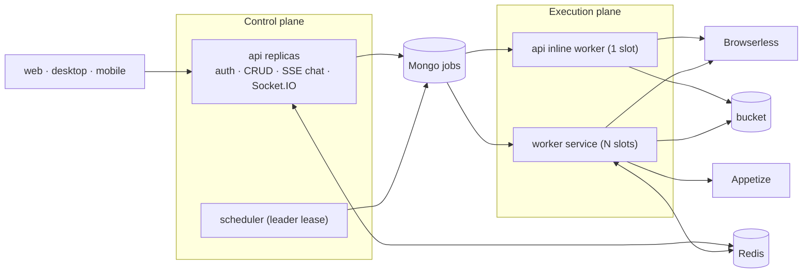

# Scaling: control plane, workers and durable jobs

How KaDeep Studios runs multi-hour campaigns across several replicas without losing work (stories 655–668, 667–668, 689).

## Two planes



- **A run is a job, not a turn.** Route runs (`POST /flows/:id/run`, `/suites/:id/run`), chat `run_suite`, automations, CI (`/api/ci/:project/run`) and MCP `flows_run` / `suites_run` all enqueue into the `jobs` collection (`apps/api/src/jobs/dispatch.ts`). The chat's own single `run_flow` stays inline so the live pane shows it.
- **Workers claim with a lease** (`claimNextJob`, atomic `Store.claim` = `findOneAndUpdate`). Heartbeats every 20 s renew the lease; a lease that expires is reallocated to another worker with the checkpoint intact; attempts exhausted → `failed` with a plain reason.
- **Checkpoints per case** (`JobCheckpoint.caseIndex`, `completedRunIds`, `suiteRunId`). Resume never repeats more than one case; the suite run row is reused so nothing is re-billed.
- **Controls from anywhere**: pause/resume/cancel/retry (`/api/jobs/:id/*`) set flags the worker honours at the next case boundary; queued jobs park immediately.
- **HITL survives replicas**: `hitl_requests` records let a phone answer a question a worker asked; timeout → the case is BLOCKED and the campaign continues.
- **Per-case timeout** (`runSettings.caseTimeoutMinutes`, default 20) stops a hung case, marks it, and moves on.
- **Backoff**: transient failures (Browserless capacity, provider 5xx/429) requeue with exponential `notBefore`.

## Processes

| Process | Start | Role |
|---|---|---|
| `api` | `npx tsx src/index.ts` | HTTP + Socket.IO; inline worker with `JOBS_API_CONCURRENCY` slots (default 1); scheduler ticks on every replica but only the `scheduler` lease holder runs automations, monitors, curation, retention and audits |
| `worker` | `npx tsx src/worker.ts` | `JOBS_WORKER_CONCURRENCY` slots (default 8); a listener-less Socket.IO server on the Redis adapter so frames / HITL / run events reach clients on the API replicas; health on `PORT` `/health` |

Both need the same variables (Mongo, Redis, Browserless, S3, OpenRouter, `SECRETS_KEY`, `JWT_SECRET`).

## Realtime across replicas

`REDIS_URL` turns on `@socket.io/redis-adapter`; every `io.to(room).emit` from any process reaches the client's replica. Without Redis everything still works single-process (the worker service warns that its events will not reach API clients).

## Health

`GET /api/health` → `platform`: replica id, db reachability, redis state, scheduler leader, queue depth (`queued/running/awaitingHuman`), workers online, provider probe (OpenRouter, cached 60 s). 503 while draining (SIGTERM).

## Railway layout (production)

- `api` — healthcheck `/api/health`, `REDIS_URL=${{Redis.REDIS_URL}}`, `LOG_JSON=1`, `DRAIN_TIMEOUT_MS=25000`
- `worker` — same repo & Dockerfile, start command `cd apps/api && npx tsx src/worker.ts`, same variables, `JOBS_WORKER_CONCURRENCY=8` (swarm shards mostly wait on remote models and browsers)
- `web`, `memory-graph`, `Browserless`, `MongoDB`, `Redis`, `neo4j`, bucket `shelved-trunk`
- The test inbox needs `INBOX_SMTP_PORT` (and `INBOX_DOMAIN`) on the `api` service plus a TCP proxy for that port; until they are set the Connections tile reports "needs operator setup" (`GET /api/projects/:id/connections/prerequisites`).

Evidence never depends on a container disk: run video pointers are written only after the bytes reached the bucket; `/artifacts` falls back to the bucket with HTTP Range.

### Browser engines (815–817)

Live Chromium always comes from Browserless. Firefox, WebKit, Chrome / Edge channels, persistent profiles, extensions
and headed windows need a real Playwright engine in the process that runs the case. The API image installs Firefox and
WebKit (`PLAYWRIGHT_ENGINES` build arg; default `chromium firefox webkit`); set `LOCAL_BROWSERS=1` on the `worker`
service to let it launch them. Without that flag a run that asks for Firefox fails with "Firefox needs a local browser
engine" — a truthful failure, never a silent Chromium — and a matrix cell shows the same text. Persistent profiles
(`runSettings.profile`) live under `DATA_DIR/profiles/<project>/<name>` on the host that created them; they are not
synced between replicas, so pin profile-based runs to one worker or a desktop worker.

## Agent swarm: many agents on one request

A big chat request (write, run or update hundreds of cases; hunt bugs across modules; localize into many locales) becomes a
**swarm**: the lead plans disjoint shards, every shard is a `swarm_shard` job on the same queue, and every worker loop on
every replica can take one. Code: `apps/api/src/swarm/` (plan, slots, pools, dedupe, shard runner), lead tools in
`agent/tools/swarm.ts` and `agent/tools/agents.ts`, background agents in `agent/agents.ts`.

**How parallel it gets.** A shard starts only while it holds two slots (`swarm/slots.ts`, atomic claims on the `slots`
collection, renewed with the job heartbeat, freed when the job ends or its lease expires):

- `swarm:<id>` — the swarm's agent count (the composer's **Agents** chip; `SWARM_AUTO_AGENTS` when it says Auto, default 8; `SWARM_MAX_AGENTS` caps it, default 64)
- its resource pool — `llm` (`SWARM_LLM_CAPACITY`, 64), `web` (`BROWSER_SESSIONS_TOTAL`, else Browserless `/pressure`), `appetize` (`APPETIZE_CONCURRENCY`, 2), `device:<name>` (1 per device), `desktop` (`SWARM_DESKTOP_CAPACITY`, 1)

A shard without both defers (no attempt is burned) and shows its place in the queue ("Waiting for a free virtual device (3
ahead)"). When a slot frees, the next waiting shards are promoted at once, so shards run back to back.

Each API process also starts `SWARM_INLINE_SLOTS` (default 16) claim loops for `swarm_shard` jobs only, because the inline
worker carries one job at a time by default. Effective parallelism = min(agent count, scarcest pool, loops online).

**Devices, desktops and accounts.**
- **Warm devices** (`swarm/warm-devices.ts`): a runner shard on `appetize` or `device:<name>` parks its device instead of closing it when more cases of the swarm wait on that pool. The slot moves with the device (holder `warm:<id>`), so the pool never runs more devices than its capacity, across replicas too.
  - The next shard on that process adopts it and resets the app, per `project.mobile.betweenCases`: `restart` (default), `reinstall`, or `fresh` (a new device per case, with a full video per case).
  - A device nobody adopts within `SWARM_WARM_DEVICE_MS` (60 s) closes.
- **Desktop agents** (`isolation: 'desktop'`: desktop-explorer, desktop-bug-hunter) hold a `desktop-agent:<project>` slot while they work, so only `SWARM_DESKTOP_CAPACITY` of them drive the paired machine at a time; the others show "waiting for the desktop".
- **Test accounts** (`swarm/accounts.ts`): a project with numbered variables (`TEST_EMAIL_2` / `TEST_PASSWORD_2`, …) gives each running case its own account through an `account:<project>` slot.
  - The case sees that account's values under the base names, so flows need no change.
  - With one account, the estimate warns that parallel cases share it.

**Following along.** Lanes show the shard's latest screen, at most one frame every `SWARM_THUMB_MS` (3 s), sent to the owner's devices only. `GET /api/swarms/:id/thumbs` serves the latest frames to a card that opens late.

**Getting the result back to the lead** (`swarm/continuation.ts`):
- The lead's turn waits up to `SWARM_TURN_HOLD_MS` (20 min) and answers from the report in the same reply.
- A swarm that outlives the turn gets a follow-up turn: only the agent's reply is saved to the chat, and open chats append it live (`chat:appended`).
- `leadNotified` is claimed once on the swarm. A replica that finished the swarm but does not hold the lead's session steps in only if nobody delivered within `SWARM_DELIVER_FALLBACK_MS` (60 s).

**Quotas hold.** Authoring shards that end short of their quota (the model stopped early, or a duplicate was never replaced) get one top-up round in their own cell before the swarm moves on, so "write 50" yields 50.

**Model calls.** Every call on one key goes through a gate (`packages/agent/src/limiter.ts`): at most
`LLM_MAX_INFLIGHT_PER_KEY` (default 32) in flight per process, halved on a 429 and grown back one slot every 30 s.

**Cost.** The estimate (tokens, $, minutes against one agent) is shown before start; above `SWARM_AUTO_START_USD`
(default $2) the swarm waits for **Start** on its card. The org budget gate applies, and a swarm pauses at 1.5× its estimate.

**Localization.** Inside one job, translation batches run in waves of `LOC_BATCH_CONCURRENCY` (default 6) after a first
seed batch; the checkpoint only moves past whole waves.

**Scaling out.** `GET /api/platform/queue` is the demand signal: queued and running work, swarm pools in use against
capacity, and the worker and Browserless replicas that would clear the queue (`desired.workers`, `desired.browserless`).
Add `worker` replicas (each adds `JOBS_WORKER_CONCURRENCY` loops) and Browserless replicas (raise `BROWSER_SESSIONS_TOTAL`
to replicas × sessions each) until `desired` is met, or let the autoscaler do it.

**Autoscaler.** `services/autoscale.ts` ticks every 30 s on the scheduler leader when `AUTOSCALE_ENABLED=1`. Desired
workers = ceil(queued + running jobs / `WORKER_SLOTS_PER_REPLICA`); desired Browserless = ceil(browser jobs + web shards /
`BROWSERLESS_SESSIONS_PER_REPLICA`), each clamped to `AUTOSCALE_{WORKER,BROWSERLESS}_{MIN,MAX}`. It scales up at once and
down only after demand stayed lower for `AUTOSCALE_DOWN_AFTER_MS` (5 min), to the highest demand of that window. It is a
dry run (logs only) until `AUTOSCALE_APPLY=1`, then sets `numReplicas` through Railway's GraphQL API
(`RAILWAY_API_TOKEN`, `RAILWAY_ENVIRONMENT_ID`, `RAILWAY_WORKER_SERVICE_ID`, `RAILWAY_BROWSERLESS_SERVICE_ID`). Its last
decision is in `/api/platform/queue` under `autoscale`. Keep `BROWSER_SESSIONS_TOTAL` unset when Browserless scales, so the
web pool follows `/pressure`.

**Measured.** `npm run bench:swarm -- --cases 50,500,1000 --agents 1,8,32` runs the real queue, slots and dedupe against a
scripted model and writes `evals/results/swarm-<date>.md`. On a laptop: 50 cases 32.6 s → 6.7 s with 8 agents; 1 000 cases
in 31 s with 32 agents (speed-up meter 29.8×), every case unique. `--real` uses real models.

## Local development without Railway

```bash
npm run dev:browserless          # Browserless-shaped shim on ws://browserless.localhost:3005
BROWSER_PLAYWRIGHT_ENDPOINT=ws://browserless.localhost:3005 npm run dev:api
```

`JOBS_INLINE=1` makes routes/tools execute synchronously in-process (the pre-queue behaviour) for debugging.
